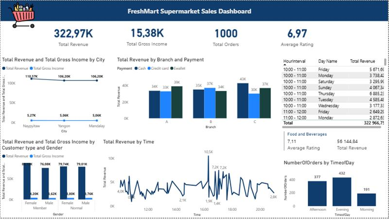
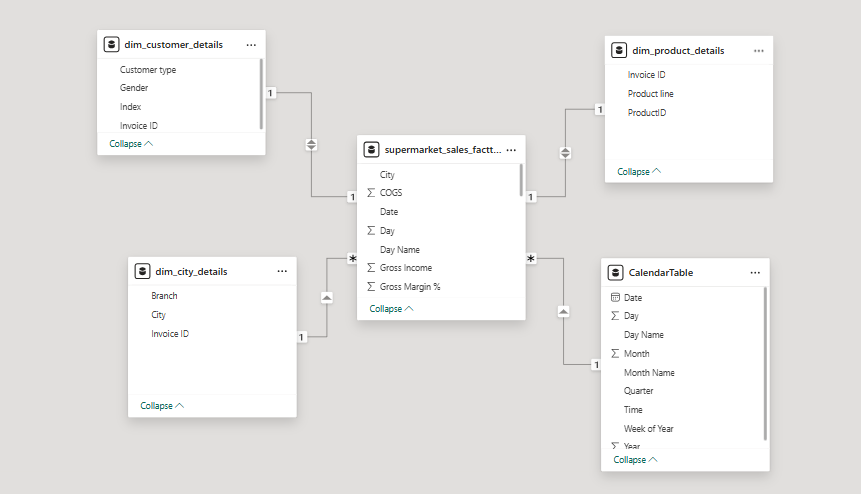

# FreshMart Superstores Sales Analysis | Power BI

Group project from the **Women Techsters Fellowship** (Data Science & Engineering), Tech4Dev.

## Overview
This project analyzes sales performance for FreshMart Superstores across three branches (Yangon, Mandalay and Naypyitaw) using a supermarket sales dataset of 1,000 transactions from January to March 2019. I cleaned and modeled the data in Power Query, built a star schema, and created an interactive Power BI dashboard covering revenue, profit, product lines, customer types and payment methods.

**Tools:** Power BI, Power Query, DAX, Excel

## Business problem
FreshMart lacked clear visibility into performance across branches, customer segments and product lines. The goals were to:
- Analyze sales and profit across cities, products and customer types
- Identify top-performing branches and products
- Explore customer behavior by gender, customer type and payment method
- Build an interactive dashboard for performance monitoring

## Data
- **Source:** a supermarket sales dataset provided for the project (Excel format)
- **Size:** 1,000 transactions, 17 columns, 3 branches, January to March 2019
- **Key fields:** Invoice ID, Branch, City, Customer Type, Gender, Product Line, Unit Price, Quantity, Total, Gross Income, Rating, Date, Time, Payment

The raw data file is not included in this repository.

## Data cleaning and modeling
1. Used the first row as headers
2. Corrected inconsistent text styling in the Product Line column
3. Removed duplicates and null values, and standardized data types and formats
4. Built a **star schema**: a sales fact table linked to product, customer and city dimension tables, plus a calendar table
5. Created calculated columns (Time of Day, Month Name, Month Number) and **DAX measures** (Total Revenue, Total Gross Income, Total Orders, Average Rating)

## Key findings
- **Dashboard totals:** 322.97K total revenue, 15.38K gross income, 1,000 orders, average rating 6.97
- **Naypyitaw** generated the highest revenue and gross income
- **Members** spent more and had higher gross income than Normal customers
- **Female customers** showed slightly higher spending
- **Food & Beverages** was the top-performing product line
- **Evening (4-9 PM)** was the busiest and most profitable period
- **Payment preferences** differed by branch: e-wallets led in Branch A and credit cards in Branch B
- **Peak months** were January and March

## Recommendations
- Expand the loyalty program to grow Member sales
- Replicate Naypyitaw's best practices in other branches
- Run targeted promotions for underperforming product lines
- Increase evening staffing to manage peak demand
- Promote e-wallet incentives
- Expand the Food & Beverages category
- Implement predictive analytics for sales forecasting

## Repository contents
| Path | What it is |
| --- | --- |
| `powerbi/FreshMart_Dashboard.pbix` | Power BI dashboard |
| `presentation/` | Team presentation (PPTX and PDF) |
| `report/FreshMart_Project_Report.pdf` | Written project report |
| `images/` | Dashboard and data model screenshots |

## My role
[Add 1-2 lines on what you did, for example: "Led the group, cleaned the data in Power Query and helped design the dashboard."]

## Team
Women Techsters Fellowship project team: [add teammates' names]

## How to use
Open the `.pbix` file in Power BI Desktop to explore the dashboard.
